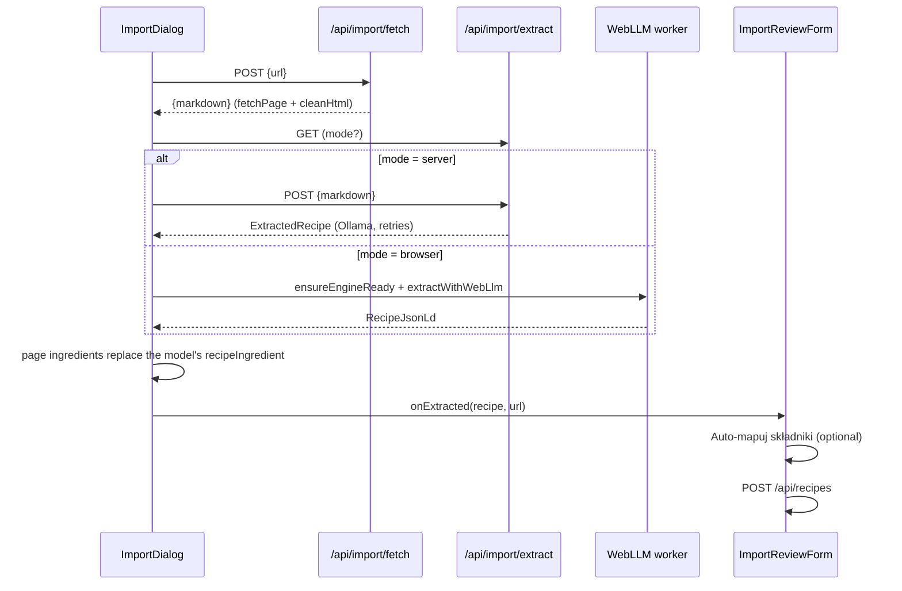

# Import Pipeline

> [!tldr]
> „Import z URL" (an outline button in the `/recipes` header beside the filled „Nowy przepis", and on `/recipes/new`) runs three stages. **Fetch and clean** happens on the server (HTML → Markdown). **Extract** runs an LLM, either WebLLM in the browser or Ollama on the server depending on `LLM_MODE`, and produces a validated `RecipeJsonLd`. **Review**: the user edits the result, auto-matches ingredients and saves through the normal `POST /api/recipes`. Nothing is saved without that review.

## Context

The target sites are jadlonomia.com and aniagotuje.pl. Each stage has its own page. This page shows how they connect. See [[concepts]].

## How it works



| Stage | Page |
|---|---|
| Fetch (`fetchPage`: custom User-Agent, throws on non-2xx) + clean (`cleanHtml`) | [[html-cleaning]] |
| Choosing browser or server | [[llm-modes]] |
| Prompt, grammar, validation, retries | [[llm-extraction]] |
| Mapping ingredient lines to DB rows | [[ingredient-auto-match]] |
| `recipeYield` → servings | [[recipe-yield-parsing]] |

The `ImportDialog` is a native `<form>` inside the shared `Sheet` (bottom sheet on mobile, centred dialog from `lg`): Enter in the URL field submits like "Importuj" (same disabled rules). Its stage machine is `idle → fetch → (model) → extract → done`, and any exception moves it to `error`. While busy the dialog lists the steps („Pobieram stronę", „Ładuję model" with a percentage bar in browser mode, „Odczytuję przepis") and marks the current one. The recipe list header links to `/recipes/new?import=1`, which opens the dialog immediately. `/recipes/new` swaps `RecipeForm` for `ImportReviewForm` once a recipe has been extracted, and passes the source URL through as `source_url` (commit `b1bd2db`).

**Error messages.** The dialog never shows `String(e)`. `src/lib/import/errors.ts` maps failures to Polish: `fetchFailureMessage` (400 bad address, upstream 404/403/5xx read from the route's "Fetch failed: N" text, 401 expired session), `extractFailureMessage` (503 passes the route's Polish „Ollama nie działa" text through, anything else is a generic „Model nie odczytał przepisu"), a rejected `fetch` (`TypeError`) becomes „Brak połączenia z serwerem", a WebLLM failure becomes a generic browser-model message, and unknown errors stay „Coś poszło nie tak". The API routes still return raw error strings; only the client maps them.

**Review screen.** `ImportReviewForm` is laid out in hairline-separated sections (details, ingredients, steps) with one filled button („Zapisz przepis"). The auto-match outcome is shown per import line as a text tag: „Dopasowano", „Utworzono — sprawdź makra" (a new ingredient was created) or „Nie dopasowano — dodaj ręcznie" (creating it failed), plus a count line. The auto-match button disappears after one run, because a second run would create the OFF/placeholder ingredients again.

## Invariants and gotchas

- **The model structures the ingredients.** It returns `{name, amount, unit, optional}` per ingredient and the dialog passes the result straight to the review form ([[0012-llm-structures-ingredients]]). There is no per-site code; quality depends on the model ([[ingredient-auto-match#Measuring the model]]).
- **Review is mandatory.** `ImportReviewForm.save` refuses to save until at least one ingredient is mapped („Zmapuj co najmniej jeden składnik przed zapisem.").
- Imported recipes get `diet_tags: []`, `allergens: []` and `visibility: 'household'`. `prep_time_min` comes from the extracted `prepTime` (ISO 8601, parsed by `parsePrepMinutes` in `src/lib/import/duration.ts`; absent or unparsable → `null`), prefilled in the editable "Czas (min)" field of the review form. Each recipe ingredient is saved with `optional: false`.
- **Review editing.** Before the first save the review form lets the user edit everything that is saved: name, servings, "Czas (min)", „Autor przepisu" (`source_author`, empty by default because extraction does not read an author; blank saves `null`), the ingredient rows and the steps. Ingredient rows are the shared `IngredientPicker` (the same one `RecipeForm` uses): add a row by searching the ingredient database or creating a new ingredient, edit raw text, amount, unit and „opcjonalny", move up/down, remove. Steps are the shared `StepsEditor`: optional title, text, move up/down, remove, „+ krok". Positions are renumbered from list order on save and steps with blank text are dropped. Editing an already saved recipe is `RecipeForm` with `recipeId` ([[recipe-management]]).
- `recipeInstructions` can be a string, an array of strings, or an array of `{text}`. The review form normalises all three into step strings.
- Review Focus #3 (a page with no recipe content) must fail validation and save nothing. The repo test `rejects JSON without name (Review Focus #3)` in `tests/unit/import/extract.test.ts` covers a missing `name` with `maxRetries` 0. On the server path, `extractRecipe` throws, the extract route answers HTTP 502, and the review form is never opened.

## Known gaps

- `/api/import/fetch` fetches any URL for any signed-in user (SSRF). See [[api-routes]].
- No caching. Importing the same URL twice repeats the fetch and the LLM run.

## Examples

```bash
# Server mode end to end (see the Ollama guide)
LLM_MODE=server pnpm dev
```

## Related

- [[concepts]]
- [[html-cleaning]]
- [[llm-modes]]
- [[llm-extraction]]
- [[ingredient-auto-match]]
- [[recipe-yield-parsing]]
- [[recipe-management]]
- [[0011-html-to-markdown-import]]

## Sources

- `src/components/import/*`, `src/app/(app)/recipes/new/page.tsx`, `src/app/api/import/**`, `src/lib/import/fetch.ts`

## Changelog

- 2026-10-13: Import redesign (#40): header entry point, `Sheet` dialog with step progress, Polish error mapping (`errors.ts`), restyled review screen with per-row auto-match outcome.
- 2026-10-13: Review screen edits steps (add, remove, move, title) and ingredient rows, and `source_author`; shares `StepsEditor` and `IngredientPicker` with `RecipeForm`.
- 2026-10-10: Ingredient lines are read from the page markup and replace the model's list when present (`acf949e`).
- 2026-10-09: Re-verified against `a7f8f52`. Corrected Review Focus #3 (missing-`name` validation, HTTP 502 on the server path) and noted `optional: false` on saved ingredients.
- 2026-10-11: Dropped the ingredients bypass; the fetch route returns only `markdown`.
- 2026-10-09: Linked the Markdown-before-extraction decision, [[0011-html-to-markdown-import]].
- 2026-10-04: Created from legacy `import.md`. Fixed the stale "review form doesn't auto-match" claim.
