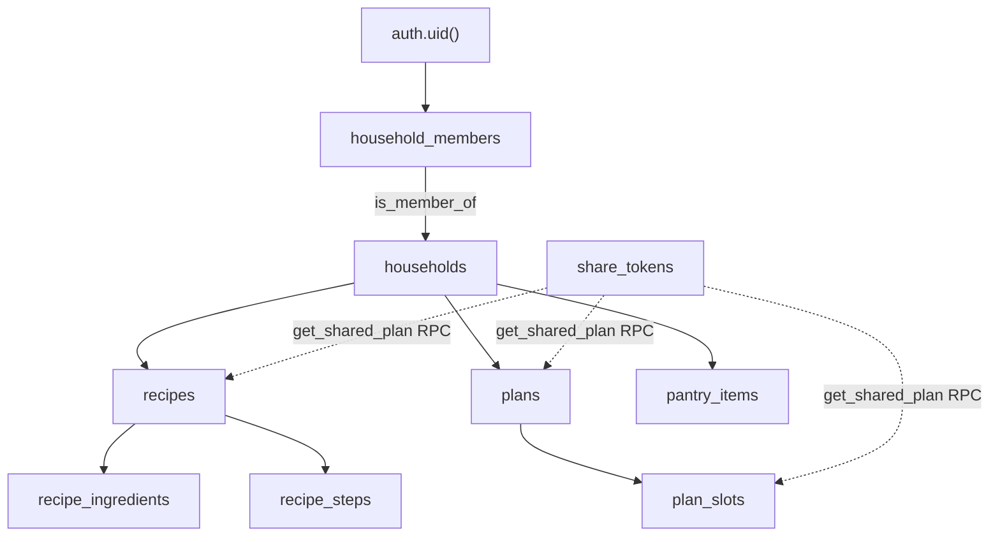

# RLS Authorization

> [!tldr]
> Route handlers don't check permissions; Postgres RLS does. Access is "member of the row's household", tested by `is_member_of()`. Ingredients are a shared catalogue: anyone signed in can add one, but only its creator or an app admin can change it (since 0010). Recipes are read by the household but changed or deleted only by their author or an app admin; other members fork them (since 0014). Since migration 0004, member policies apply to `authenticated` only, and invites, member removal and token creation are locked down. Since 0005, anonymous share links go through the `get_shared_plan` RPC, not policies.

## Context

Every query runs as the user, through the anon key and the session cookie (see [[auth-session]]), so a missing or loose policy is a real hole. The full policy list is in [[database-schema#RLS policies]]. This page explains the model and its risks. See [[concepts]].

## How it works



- `is_member_of(hid)` is `security definer`, so it can read `household_members` without hitting that table's own policies recursively. `is_owner_of(hid)` works the same way. Both pin `search_path` and only `authenticated` can execute them.
- Member policies are `to authenticated`. `anon` reaches data only through `ing_select` and the `get_shared_plan` RPC (0005). A policy that applies to `anon` must not call `is_member_of`: `anon` has no `execute` on it, so the query would fail instead of returning no rows.
- Child tables (`recipe_ingredients`, `recipe_steps`, `plan_slots`) check access through their parent with `exists (…)`. Since 0014 the recipe children split by command: `ri_select` / `rs_select` keep the household rule, while `ri_insert|update|delete` and `rs_insert|update|delete` need the parent recipe's author or an app admin, like `rec_update` / `rec_delete`.
- Recipe writes (since 0014): `rec_update` and `rec_delete` need `author_id = auth.uid()` or `is_app_admin()`. `rec_update`'s `with check` also keeps the recipe in a household the caller belongs to and stops an author from handing it to someone else. Another member edits a fork made by `fork_recipe` (`security invoker`: it only reads and inserts what these policies already allow). See [[0015-recipe-forks]].
- Same-command policies are OR'd. Sharing adds no policies: `get_shared_plan` is `security definer` and returns only what a token unlocks. See [[share-links]] and [[0008-share-link-rpc]].

## Where the code adds checks anyway

- `inviteMember` checks caller membership explicitly (see [[household-model]]).
- `POST /api/recipes`, `GET /api/plans` and `GET /api/shopping` resolve the household server-side, so the client can't choose one.

## Invariants and gotchas

- **An RLS-filtered write isn't an error.** A delete or update that RLS hides affects 0 rows and returns no error, so code that must report a refusal checks the row count. `update_recipe` raises `42501` when no row was updated (migration 0009), and `PUT /api/recipes/[id]` returns 403. `DELETE /api/recipes/[id]` asks for the deleted rows back (`deleteRecipe`) and returns 403 when there are none.
- **An RLS-hidden join returns null.** `getWeekPlan` embeds `recipe:recipes(…)`. If the recipe isn't visible, `slot.recipe` is null while `slot.recipe_id` is set, which is why the UI shows „przepis niedostępny" for an unavailable recipe. See [[week-plan]].
- When adding a table, enable RLS **and** write policies in the same migration. A table with RLS enabled and no policies denies everything, which fails safe but is confusing.

## Known gaps

| Policy | Looseness | Impact |
|---|---|---|
| `rec_select` `visibility = 'public_link'` | Readable by any signed-in user without membership | No UI sets `public_link`, so this is latent. Since 0004 `anon` can't read it. |

Fixed in 0014: `rec_update` (any member could edit any household recipe, including `author_id`) and `ri_all` / `rs_all` (any member could insert, change or delete another member's recipe ingredients and steps). Writes now need the author or an app admin; see [[0015-recipe-forks]].

Fixed in 0010: `ing_update` (any signed-in user could change any ingredient's macros) and `ing_insert` (any `created_by`). Updates now need the creator or an app admin (`is_app_admin()`, backed by `app_admins`, which no client can read or write). See [[0013-ingredient-ownership-and-app-admins]].

Fixed in 0005: `st_select using (true)` and the `*_select_via_share_token` policies (token and plan enumeration).

Fixed in 0004: `hm_insert` (self-join, even as owner), `hm_delete` (any member could remove anyone, including the owner), `households_insert` (open to `anon`), `st_insert` (a token for any plan, which exposed that plan through the share-token policies), and `anon` execute on the `security definer` functions.

## Examples

```sql
-- As anon: no table access, only the RPC (since 0005)
set role anon;
select count(*) from share_tokens;     -- 0
select get_shared_plan('<token>');     -- the plan that token unlocks, or null
```

## Related

- [[concepts]]
- [[database-schema]]
- [[household-model]]
- [[share-links]]
- [[0001-rls-is-the-authz-boundary]]
- [[0003-share-token-rls]]
- [[0008-share-link-rpc]]
- [[0013-ingredient-ownership-and-app-admins]]
- [[0015-recipe-forks]]
- [[recipe-management]]

## Sources

- `supabase/migrations/0001_initial.sql`, `0002_share_token_rls.sql`, `0004_security_hardening.sql`, `0005_share_link_rpc.sql`, `0010_ingredient_ownership.sql`, `0014_recipe_fork.sql`
- `src/app/api/recipes/[id]/route.ts` (`DELETE`), `src/lib/db/recipes.ts` (`deleteRecipe`)
- `AGENTS.md`: "RLS is the authorization boundary"

## Changelog

- 2026-10-13: Updated for migration 0014: recipe and recipe-child writes limited to the author or an app admin, `fork_recipe`, and the delete route's 403. Removed the `rec_update` gap and the silent-delete gotcha.
- 2026-10-13: Updated for migration 0010: ingredient updates limited to the creator or an app admin; removed the `ing_update` gap.
- 2026-10-09: UI string for an RLS-hidden recipe changed from „przepis usunięty" to „przepis niedostępny" (issue #16).
- 2026-10-09: Re-verified against a7f8f52 against migrations 0001, 0002, 0004, 0005 and the policy text. Corrected the route list (`/api/plans` and `/api/shopping` are GET). 0006 and 0007 add no policies.
- 2026-10-09: Terminology aligned with GLOSSARY.md.
- 2026-10-04: Updated for migration 0005: sharing goes through `get_shared_plan`; token enumeration fixed.
- 2026-10-04: Updated for migration 0004. Moved the fixed gaps out of the table and added the `anon` / `is_member_of` rule.
- 2026-10-04: Created from the RLS notes in legacy `database.md`. Added the token-enumeration, self-join and silent-delete findings.
